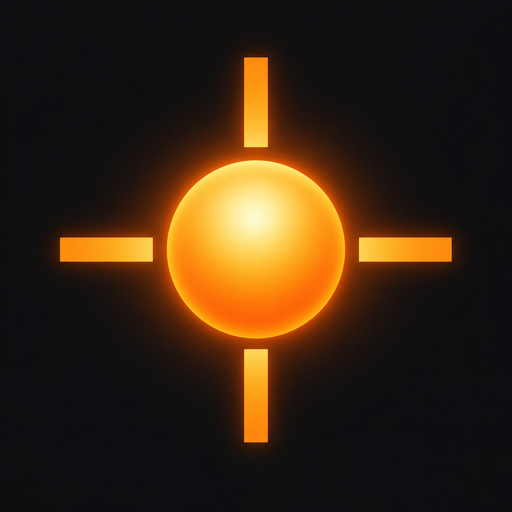

# DSBYTE AIM

一款可直接在浏览器中游玩的 FPS 瞄准训练器。进入页面后调整参数，点击开始训练，即可在 3D 靶场中练习 Gridshot。

**在线体验：** [dsbyte-aim.netlify.app](https://dsbyte-aim.netlify.app/)



## 功能

- 三个球形目标持续随机出现；命中后立即补靶，并显示闪光、碎片和扩散环。
- 提供 30 秒、60 秒训练，以及灵敏度、准星、目标大小、目标颜色和音效设置。
- 显示分数、命中率、最长连击和击中耗时；射偏会中断连击，但不会扣分。
- 设置与成绩保存在浏览器本地。标准目标大小的成绩进入对应时长的本地排行榜。
- 支持暂停、继续、重新开始和训练结果查看。

## 运行要求

需要支持 **WebGL 2** 和 **Pointer Lock** 的桌面浏览器，以及键盘和鼠标。移动设备目前不支持触屏训练。成绩只保存在当前浏览器，不会跨设备同步。

## 本地开发

需要 Node.js 和 npm。在项目目录运行：

```bash
npm install
npm run dev
```

打开终端显示的本地地址。常用命令：

```bash
npm test        # 运行单元测试
npm run build   # 类型检查并构建到 dist/
npm run preview # 预览构建结果
```

## 操作

| 操作 | 控制 |
| --- | --- |
| 瞄准 | 移动鼠标 |
| 射击 | 鼠标左键 |
| 暂停或退出鼠标锁定 | `Esc` |
| 快速重开 | `R` |

页面失焦时训练会暂停。继续训练后会重新倒数，倒数结束前不能射击。

## 技术栈

React、TypeScript、Three.js、React Three Fiber 和 Vite。音效由 Web Audio 在本地生成，设置与记录使用浏览器本地存储。

## 部署

`netlify.toml` 已配置构建命令 `npm run build` 和发布目录 `dist`。仓库中的源码可用于重新部署；当前线上站点由 Netlify 托管。
